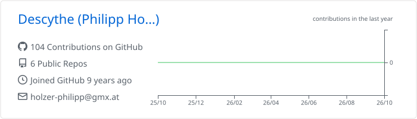
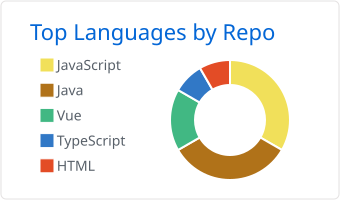
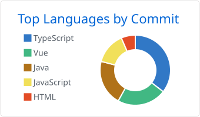

## Hi, my name is Philipp 👋

<picture>
  <source media="(prefers-color-scheme: dark)" srcset="https://raw.githubusercontent.com/Descythe/Descythe/main/profile-summary-card-output/github_dark/0-profile-details.svg">
  
</picture>
<br />
<picture>
  <source media="(prefers-color-scheme: dark)" srcset="https://raw.githubusercontent.com/Descythe/Descythe/main/profile-summary-card-output/github_dark/1-repos-per-language.svg">
  
</picture>
<picture>
  <source media="(prefers-color-scheme: dark)" srcset="https://raw.githubusercontent.com/Descythe/Descythe/main/profile-summary-card-output/github_dark/2-most-commit-language.svg">
  
</picture>

## About me

Senior Software Developer at **Wiener Linien** in Vienna, Austria, building solutions on the ELO ECM platform. I care about **software architecture, clean code, and reliable, maintainable systems**, and about the processes that help teams build better software.

- **Education:** Software Engineering at TU Wien
- **Focus:** Software Architecture, DevOps & UX
- **Certifications:** iSAQB Foundation Level, UXQCC Foundation Level, ITIL Foundation & Six Sigma Green Belt

## Tech stack

```json
{
  "languages": ["Java", "TypeScript", "SQL"],
  "frameworks": ["React", "Vue"],
  "web": ["HTML", "CSS", "JavaScript"],
  "platforms": ["ELO"],
  "tools": ["Docker", "Kubernetes", "Git"]
}
```

## Current projects

## Contact

[](https://www.linkedin.com/in/philipp-holzer-307397194/)
&nbsp;
[](https://www.xing.com/profile/Philipp_Holzer7)
