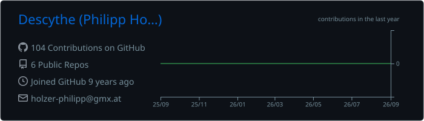
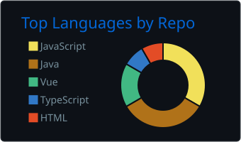
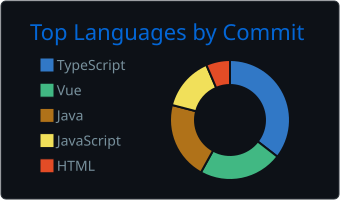

## Hi, my name is Philipp 👋

 

 

## About me

I'm a software engineering professional based in Vienna, Austria, with a background in computer science from TU Wien and professional experience at Wiener Linien.

I'm particularly interested in **software architecture, clean code, and building reliable, maintainable systems**. I enjoy understanding how complex systems work, solving technical problems, and continuously improving my approach to software development.

My interests extend beyond writing code to software quality, user experience, and the processes that help teams build better software.

- **Background:** Software Engineering at TU Wien
- **Professional experience:** Wiener Linien
- **Areas of interest:** Software Architecture, Software Engineering, DevOps & UX
- **Certifications:** iSAQB Foundation Level, UXQCC Foundation Level, ITIL Foundation & Six Sigma Green Belt
- **Location:** Vienna, Austria

## Current projects

## Contact

## Social Media

